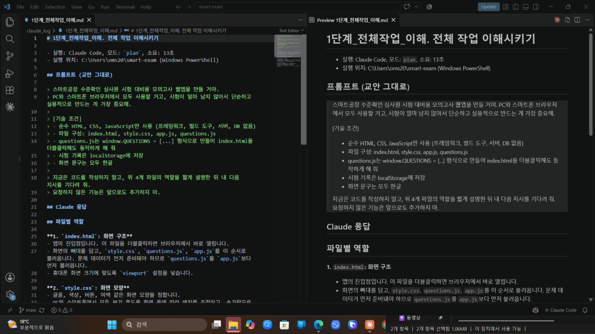
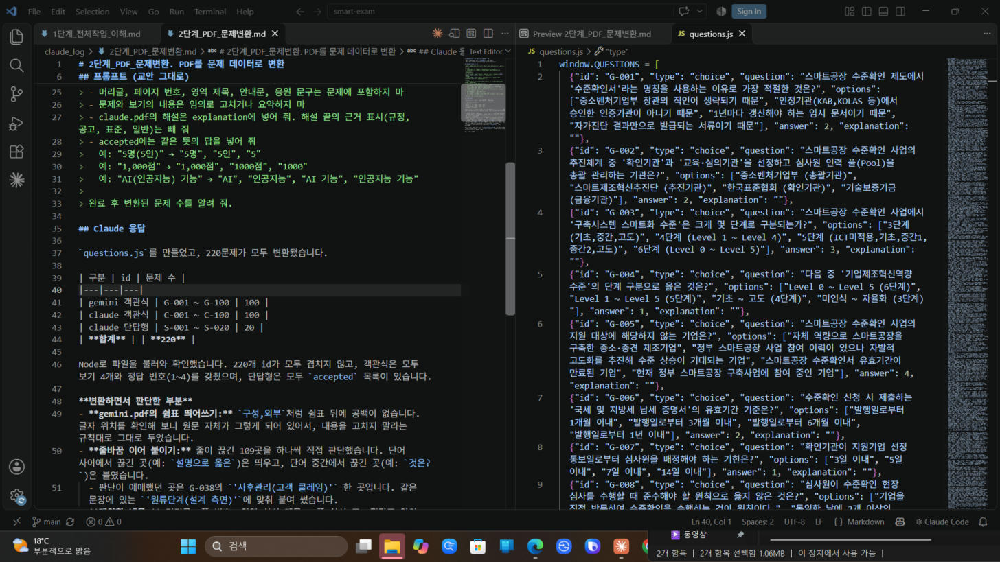
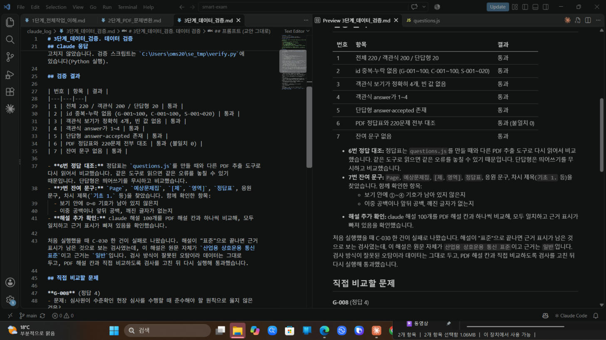
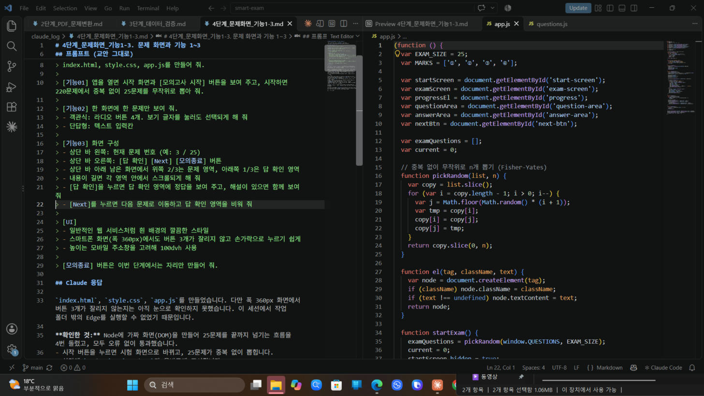
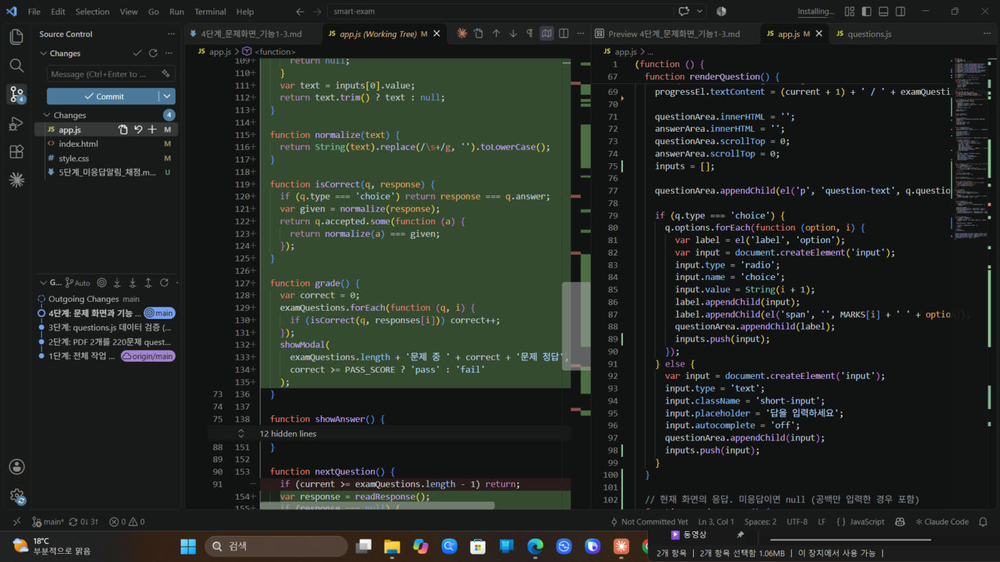
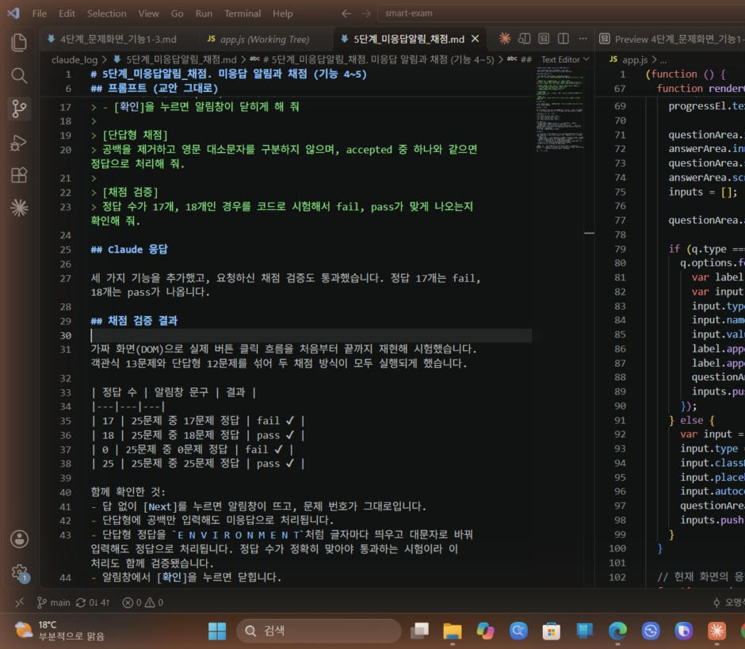
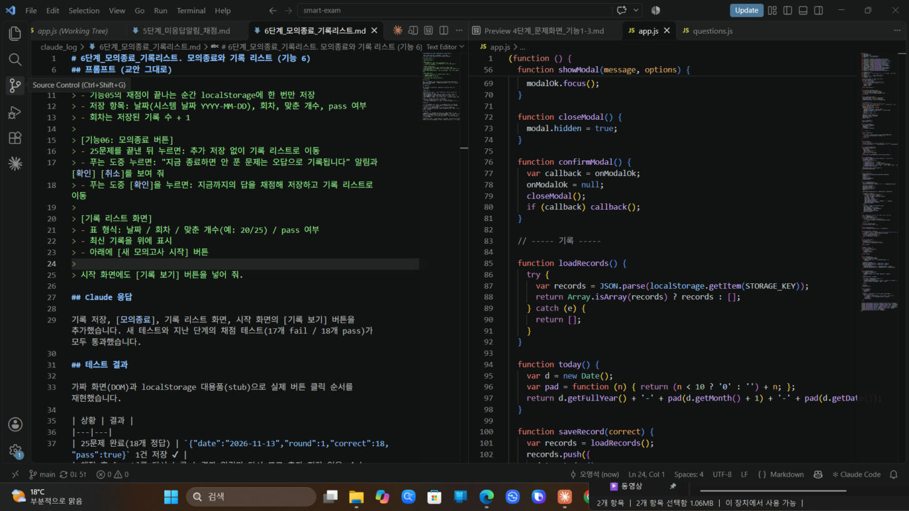
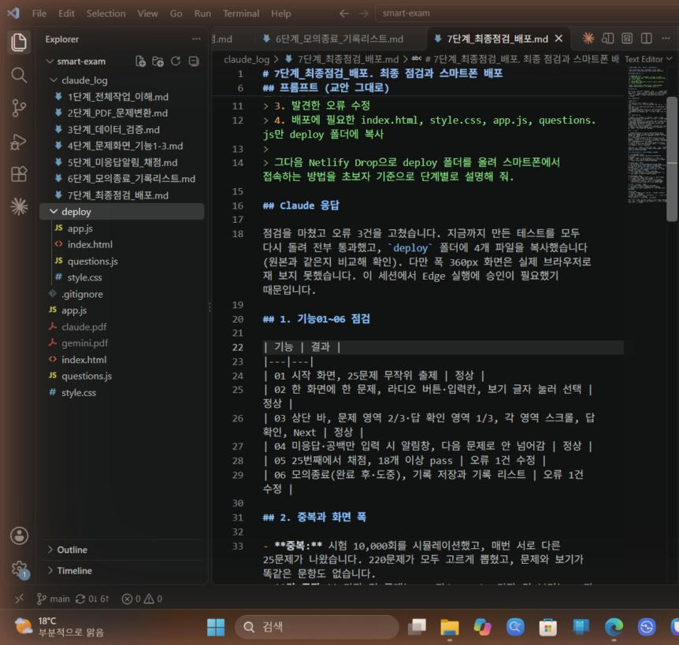
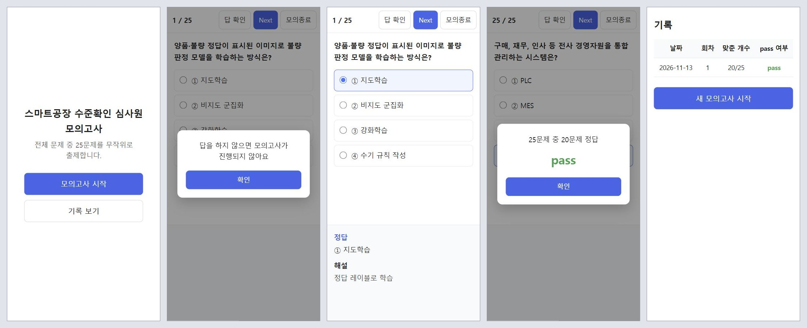

# 스마트공장 수준확인 심사원 모의고사 웹앱

해사소프트웨어 7번째 과제(11주 시험문제 연습 웹프로젝트)입니다. 11주 강의교안의 단계별 프롬프트를 Claude Code에 하나씩 넣어서 만들었습니다.

교육 때 받은 교재로 만든 예상문제 220문제(Gemini 100문제, Claude 120문제)를 바탕으로, PC와 스마트폰 브라우저에서 25문제씩 모의고사를 풀 수 있는 웹앱입니다.

## 사용 방법

- **PC:** `index.html`을 더블클릭하면 바로 열립니다(서버 필요 없음).
- **스마트폰:** `deploy` 폴더를 [Netlify Drop](https://app.netlify.com/drop)에 끌어다 놓으면 주소가 나옵니다. 휴대폰에서 그 주소를 열고 홈 화면에 추가하면 됩니다(자세한 순서는 [7단계 로그](claude_log/7단계_최종점검_배포.md) 참고).
- **기록 저장:** 시험 기록은 브라우저의 localStorage에 저장되므로 PC와 스마트폰의 기록은 따로 남습니다.

## 파일 구성

| 파일 | 역할 |
|---|---|
| `index.html` | 화면 구조 (시작, 문제, 기록 화면과 알림창) |
| `style.css` | 화면 모양 (360px 폭에서도 버튼 3개가 한 줄에 들어가게) |
| `app.js` | 출제, 답 확인, 미응답 알림, 채점, 기록 저장 |
| `questions.js` | 220문제 데이터 (`window.QUESTIONS = [...]`) |
| `deploy/` | 배포용 4개 파일 사본 |
| `claude_log/` | 단계별 프롬프트와 Claude 응답 원문 |

원본 문제 PDF 2개는 저장소에 올리지 않았습니다(`.gitignore`).

## 구현한 기능

| 기능 | 내용 |
|---|---|
| 01 | 220문제에서 중복 없이 25문제를 무작위로 출제 |
| 02 | 한 화면에 한 문제, 객관식은 라디오 버튼, 단답형은 입력칸 |
| 03 | 상단 바에 [답 확인] [Next] [모의종료], 아래 화면은 문제 2/3, 답 확인 1/3 |
| 04 | 답을 안 하고 [Next]를 누르면 "답을 하지 않으면 모의고사가 진행되지 않아요" 알림 |
| 05 | 25번째 문제 뒤 채점, 18문제 이상 pass, 18문제 미만 fail |
| 06 | [모의종료]를 누르면 날짜, 회차, 맞춘 개수, pass 여부 기록 리스트 표시 |

---

## 실습 기록 (7번째 과제)

교안의 1~7단계 프롬프트를 고치지 않고 그대로 Claude Code에 넣었습니다. Claude Code는 PowerShell에서 `claude -p`로 실행했고, 2단계부터는 `-c` 옵션으로 앞 단계 대화를 이어 갔습니다. 그래서 1단계에서 정한 조건(순수 HTML·CSS·JS, 요청하지 않은 기능 추가 금지)을 Claude가 끝까지 기억합니다. 단계마다 프롬프트와 응답을 `claude_log`에 저장하고 커밋했습니다.

| 단계 | 내용 | 결과 |
|---|---|---|
| 1 | 전체 작업 이해시키기 (Plan 모드) | 4개 파일 역할 설명, 코드 작성 없음 |
| 2 | PDF를 문제 데이터로 변환 | 220문제 (G 100, C 100, S 20) |
| 3 | 데이터 검증 | 7개 항목 통과, PDF 정답표와 불일치 0 |
| 4 | 문제 화면과 기능 1~3 | index.html, style.css, app.js 생성 |
| 5 | 미응답 알림과 채점 (기능 4~5) | 정답 17개 fail, 18개 pass 확인 |
| 6 | 모의종료와 기록 리스트 (기능 6) | localStorage에 회차별 기록 |
| 7 | 최종 점검과 배포 준비 | 오류 3건 수정, deploy 폴더 |

### 1단계. 전체 작업 이해시키기
코드를 쓰기 전에 기술 조건만 알려 주고 4개 파일의 역할을 설명하게 했습니다. Plan 모드라서 파일은 하나도 만들어지지 않았습니다.

### 2단계. PDF를 문제 데이터로 변환
Claude가 두 PDF를 읽어 220문제를 `questions.js`로 만들었습니다. 오른쪽이 만들어진 데이터입니다. 줄이 끊긴 109곳을 어떻게 이어 붙였는지, 원문의 띄어쓰기를 왜 그대로 두었는지도 설명해 줬습니다.

### 3단계. 데이터 검증
검증 스크립트로 7개 항목을 확인했습니다. 정답은 변환할 때와 다른 PDF 추출 도구로 다시 읽어 대조했습니다. 처음에 C-030 한 건이 실패로 나왔는데, 데이터가 아니라 검사 방식의 오탐이어서 검사를 고친 뒤 통과했습니다.

### 4단계. 문제 화면과 기능 1~3
`index.html`, `style.css`, `app.js`를 만들었습니다. 오른쪽은 25문제를 중복 없이 뽑는 코드(Fisher-Yates 섞기)입니다.

### 5단계. 미응답 알림과 채점
VS Code 소스 제어의 diff 화면입니다. 초록색 부분이 이번에 추가된 채점 코드입니다. 단답형은 공백을 지우고 소문자로 바꿔 `accepted`와 비교하고, 18문제 이상이면 pass입니다.

정답 수 17개, 18개, 0개, 25개인 경우를 코드로 시험한 결과입니다.

### 6단계. 모의종료와 기록 리스트
채점이 끝나는 순간 localStorage에 한 번만 저장합니다. 오른쪽은 기록을 읽고 저장하는 코드입니다.

### 7단계. 최종 점검과 배포 준비
전체를 다시 점검해 오류 3건을 고쳤습니다. 채점 후 답을 바꾸면 기록과 알림 점수가 달라지던 문제, 저장소가 막힌 브라우저에서 멈추던 문제, 옛 iOS에서 알림창 배경이 덜 덮이던 문제입니다. 배포용 4개 파일은 왼쪽 탐색기의 `deploy` 폴더에 복사했습니다.

### 8. 스마트폰 폭(360px)에서 직접 확인
Claude Code는 실제 브라우저로 화면을 확인하지 못했다고 여러 번 말했습니다. 그래서 브라우저를 폭 360px로 줄여 직접 확인했습니다. 순서대로 시작 화면, 답 없이 [Next], 답 확인, 25번 채점 결과(20/25 pass), 기록 리스트입니다.

- 상단 버튼 3개의 오른쪽 끝은 352px로, 화면 폭 360px 안에 들어왔습니다. 버튼 높이는 44px이고 가로 스크롤은 생기지 않았습니다.
- 20문제를 맞히고 5문제를 틀리게 답했더니 "25문제 중 20문제 정답, pass"가 나왔고, 기록에도 20/25로 저장됐습니다.

## 남은 한계

- **문제집끼리 다른 정답:** 교안에서 짚은 것처럼, 두 문제집은 기업제조혁신역량 수준 단계(G-004와 C-066, S-004)와 구축시스템 스마트화 수준 단계(G-003과 S-003)가 서로 다릅니다. 지금은 각 PDF의 정답표를 그대로 따르므로, 교재로 확인한 뒤 맞지 않는 쪽을 고쳐야 합니다.
- **문제 데이터의 신뢰도:** 문제 자체가 AI로 만든 예상문제라, 정답표와 일치해도 교재 내용과 다를 수 있습니다.
- **기록 공유 안 됨:** 기록은 기기마다 따로 저장되고, 브라우저 데이터를 지우면 사라집니다.
- **실제 기기 확인:** 360px 확인은 PC 브라우저의 화면 크기 흉내로 했습니다. 실제 휴대폰에서도 한 번 열어 보는 것이 좋습니다.
